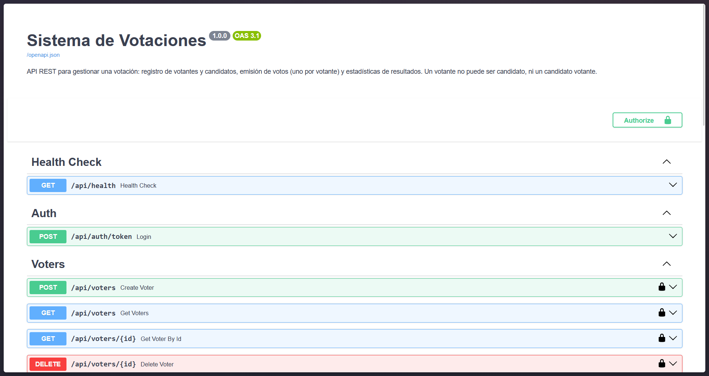
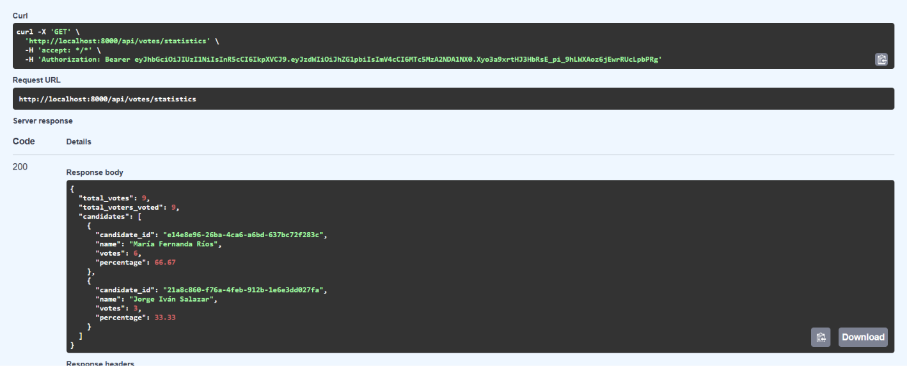

# Sistema de Votaciones

_API REST desarrollada con FastAPI para gestionar un proceso de votación: registra votantes y candidatos, permite que cada votante emita **un único voto** y entrega estadísticas de los resultados. Un votante no puede registrarse como candidato, ni un candidato como votante._

_El proyecto se desarrolló como prueba técnica. Además de cumplir los endpoints pedidos, incluye autenticación con JWT, paginación y filtros en los listados, y validaciones que mantienen las estadísticas consistentes._

## Comenzando 🚀

_Estas instrucciones te permitirán obtener una copia del proyecto funcionando en tu máquina local._

### Pre-requisitos 📋

_Antes de comenzar, asegúrate de tener instalado:_

- [Docker](https://docs.docker.com/get-started/get-docker/) (con Docker Compose)
- [Git](https://git-scm.com) (opcional, pero recomendado)
- [uv](https://docs.astral.sh/uv/getting-started/installation/) (solo si vas a correr la API fuera de Docker. Si no tienes Python 3.12, uv lo descarga automáticamente)

_También necesitas libres los puertos `8000` (API) y `55432` (PostgreSQL)._

### Instalación 🔧

1. Clona el repositorio

```bash
git clone https://github.com/Loperaa-Juan/New-Inntech-Rest-API.git
cd New-Inntech-Rest-API
```

2. Configura las variables de entorno

Crea un archivo `.env` en la raíz del proyecto, usando `.env.example` como plantilla.

```bash
# Windows
copy .env.example .env

# macOS o Linux
cp .env.example .env
```

Actualiza el archivo `.env` con tus valores:

| Variable | Descripción |
|----------|-------------|
| `POSTGRES_USER`, `POSTGRES_PASSWORD`, `POSTGRES_DB` | Credenciales y nombre de la base de datos que crea el contenedor de PostgreSQL. |
| `DATABASE_URL` | Conexión a PostgreSQL cuando la API corre fuera de Docker: `postgresql+psycopg://<usuario>:<contraseña>@127.0.0.1:55432/<nombre_db>`. Dentro de Docker, Compose la reemplaza para apuntar al contenedor `db`. |
| `JWT_SECRET_KEY` | Clave para firmar los tokens. |
| `JWT_EXPIRE_MINUTES` | Minutos que dura un token (por defecto `30`). |
| `ADMIN_USERNAME`, `ADMIN_PASSWORD` | Usuario y contraseña del administrador, con los que se obtiene el token. |

Genera la clave de `JWT_SECRET_KEY` con:

```bash
python -c "import secrets; print(secrets.token_hex(32))"
```

_La API no arranca si falta `JWT_SECRET_KEY`, `ADMIN_USERNAME` o `ADMIN_PASSWORD`._

3. Levanta el proyecto

**Opción A: todo con Docker (recomendado).** Levanta PostgreSQL y la API. La primera vez tarda más porque descarga las imágenes y las dependencias.

```bash
docker compose up --build
```

**Opción B: API local con uv.** Levanta solo la base de datos, instala las dependencias y arranca la API.

```bash
docker compose up -d db
uv sync
uv run fastapi dev
```

4. Abre la documentación

La documentación interactiva (Swagger) queda en **http://localhost:8000/docs**. La raíz `/` redirige ahí.



_Swagger lista todos los endpoints. Los que tienen candado requieren token, que se obtiene con el botón **Authorize**._

_Las tablas se crean solas al arrancar la API. Para empezar con la base vacía, corre `docker compose down -v` (borra todos los datos)._

## Autenticación 🔐

_Todas las rutas de votantes, candidatos y votos (incluida `/votes/statistics`) requieren el header `Authorization: Bearer <token>`. Sin token, o con uno vencido o inválido, responden `401`._

Para obtener el token, envía `username` y `password` del administrador a `POST /api/auth/token` **como formulario** (`application/x-www-form-urlencoded`), no como JSON:

```bash
curl -X POST http://localhost:8000/api/auth/token \
  -d "username=admin" \
  -d "password=tu_contraseña"
```

```json
{ "access_token": "eyJhbGciOiJIUzI1NiIsInR5cCI6IkpXVCJ9...", "token_type": "bearer" }
```

_En Swagger, usa el botón **Authorize** con el mismo usuario y contraseña; desde ahí todas las peticiones llevan el token._

## Endpoints 📡

_Todas las rutas tienen el prefijo **`/api`**._

| Método | Ruta | Descripción | Respuestas |
|--------|------|-------------|------------|
| `POST` | `/api/auth/token` | Obtener un token JWT. | `200`, `401`, `422` |
| `GET` | `/api/health` | Verificar que la API está activa. | `200` |
| `POST` | `/api/voters` | Registrar un votante. | `201`, `409`, `422` |
| `GET` | `/api/voters` | Listar votantes (paginado y con filtros). | `200`, `422` |
| `GET` | `/api/voters/{id}` | Obtener un votante. | `200`, `404`, `422` |
| `DELETE` | `/api/voters/{id}` | Eliminar un votante (responde sin cuerpo). | `204`, `404`, `409`, `422` |
| `POST` | `/api/candidates` | Registrar un candidato. | `201`, `409`, `422` |
| `GET` | `/api/candidates` | Listar candidatos (paginado y con filtros). | `200`, `422` |
| `GET` | `/api/candidates/{id}` | Obtener un candidato. | `200`, `404`, `422` |
| `DELETE` | `/api/candidates/{id}` | Eliminar un candidato (responde sin cuerpo). | `204`, `404`, `409`, `422` |
| `POST` | `/api/votes` | Emitir un voto. | `201`, `404`, `409`, `422` |
| `GET` | `/api/votes` | Listar todos los votos. | `200` |
| `GET` | `/api/votes/statistics` | Estadísticas de la votación. | `200` |

_Además, todas las rutas excepto `/api/auth/token` y `/api/health` pueden responder `401`._

| Código | Cuándo |
|--------|--------|
| `401` | Falta el token, está vencido o es inválido; o el usuario y la contraseña son incorrectos. |
| `404` | El votante o el candidato no existe (también al votar con un `voter_id` o `candidate_id` inexistente). |
| `409` | Email o documento ya registrado; documento que ya pertenece a la otra tabla (votante ↔ candidato); el votante ya votó; eliminar un votante que ya votó o un candidato con votos. |
| `422` | Datos inválidos: campos faltantes, email mal formado, `id` que no es un UUID, `limit` fuera de rango, etc. |

### Paginación y filtrado 🔎

_`GET /api/voters` y `GET /api/candidates` aceptan estos parámetros de consulta:_

| Parámetro | Aplica a | Descripción |
|-----------|----------|-------------|
| `skip` | ambos | Cuántos resultados saltar. Por defecto `0`. |
| `limit` | ambos | Cuántos resultados devolver. Por defecto `20`, máximo `100`. |
| `name` | ambos | Búsqueda parcial por nombre, sin distinguir mayúsculas. |
| `has_voted` | votantes | `true` o `false`. |
| `party` | candidatos | Búsqueda parcial por partido, sin distinguir mayúsculas. |

_Los resultados se ordenan por nombre, y `total` cuenta todos los resultados que cumplen los filtros, no solo los de la página._

```bash
curl "http://localhost:8000/api/voters?has_voted=false&skip=0&limit=10" \
  -H "Authorization: Bearer $TOKEN"
```

```json
{
  "items": [
    { "name": "Ana Gómez", "email": "ana@example.com", "document_number": "1001", "id": "3f1c...", "has_voted": false }
  ],
  "total": 1,
  "skip": 0,
  "limit": 10
}
```

## Ejemplos de uso ⚙️

_Flujo completo, desde el login hasta las estadísticas. Los ejemplos usan la sintaxis de bash (en Windows, puedes correrlos desde Git Bash o WSL)._

1. Guarda el token en una variable

```bash
TOKEN="<access_token>"
```

2. Registra un votante (`201`)

```bash
curl -X POST http://localhost:8000/api/voters \
  -H "Authorization: Bearer $TOKEN" \
  -H "Content-Type: application/json" \
  -d '{"name": "Ana Gómez", "email": "ana@example.com", "document_number": "1001"}'
```

```json
{ "name": "Ana Gómez", "email": "ana@example.com", "document_number": "1001", "id": "<voter_id>", "has_voted": false }
```

3. Registra un candidato (`201`)

```bash
curl -X POST http://localhost:8000/api/candidates \
  -H "Authorization: Bearer $TOKEN" \
  -H "Content-Type: application/json" \
  -d '{"name": "Carlos Pérez", "document_number": "2001", "party": "Partido Verde"}'
```

```json
{ "name": "Carlos Pérez", "document_number": "2001", "party": "Partido Verde", "id": "<candidate_id>", "votes": 0 }
```

4. Intenta registrar al votante como candidato (`409`)

```bash
curl -X POST http://localhost:8000/api/candidates \
  -H "Authorization: Bearer $TOKEN" \
  -H "Content-Type: application/json" \
  -d '{"name": "Ana Gómez", "document_number": "1001"}'
```

```json
{ "detail": "El documento pertenece a un votante. Un votante no puede ser candidato" }
```

5. Emite un voto (`201`)

_Marca al votante con `has_voted: true` y suma un voto al candidato._

```bash
curl -X POST http://localhost:8000/api/votes \
  -H "Authorization: Bearer $TOKEN" \
  -H "Content-Type: application/json" \
  -d '{"voter_id": "<voter_id>", "candidate_id": "<candidate_id>"}'
```

```json
{ "voter_id": "<voter_id>", "candidate_id": "<candidate_id>", "id": "<vote_id>" }
```

6. Vota por segunda vez con el mismo votante (`409`)

```json
{ "detail": "El votante ya ha emitido su voto." }
```

7. Consulta las estadísticas (`200`)

```bash
curl http://localhost:8000/api/votes/statistics \
  -H "Authorization: Bearer $TOKEN"
```

## Estadísticas 📊

_`GET /api/votes/statistics` devuelve el total de votos, cuántos votantes ya votaron y, por cada candidato (de más a menos votado), sus votos y su porcentaje sobre el total, redondeado a dos decimales._



_Resultado en Swagger con 9 votantes y 2 candidatos: 6 votos para uno y 3 para el otro._

_Si todavía no hay votos, todos los porcentajes son `0.0`._

## Decisiones de diseño 🧠

- **UUID como identificador** de votantes, candidatos y votos.
- **`document_number` en votantes y candidatos.** Es el campo con el que se valida que un votante no sea candidato y viceversa. El nombre no sirve porque dos personas pueden llamarse igual, y los candidatos no tienen email.
- **Un único voto por votante, garantizado dos veces:** la API revisa `has_voted` antes de votar, y la base de datos tiene una restricción `UNIQUE` en `vote.voter_id`, que frena dos votos simultáneos del mismo votante.
- **Voto en una sola transacción:** guardar el voto, marcar `has_voted` y sumar el voto al candidato ocurren juntos o no ocurre ninguno. El conteo se incrementa en la base de datos (`votes = votes + 1`), así dos votos al mismo tiempo no se pisan.
- **No se puede eliminar un votante que ya votó ni un candidato con votos** (`409`), para que las estadísticas sigan cuadrando.
- **Un único administrador definido en `.env`**, sin tabla de usuarios: los votantes no inician sesión; el administrador registra los votos.
- **Prefijo `/api`** en todas las rutas, para separar la API de la raíz, que redirige a la documentación.

## Estructura del proyecto 📂

```
app/
├── main.py          # Crea la aplicación FastAPI y registra las rutas
├── api/routes/      # Endpoints: auth, health, voters, candidates, votes
├── services/        # Lógica de negocio y validaciones
├── schemas/         # Modelos de Pydantic para las peticiones y respuestas
├── models/          # Modelos de SQLAlchemy (tablas)
├── db/              # Conexión a la base de datos
└── Dockerfile
docker-compose.yml   # PostgreSQL y la API
```

## Construido con 🛠️

- [Python 3.12](https://www.python.org/) (lenguaje)
- [FastAPI](https://fastapi.tiangolo.com/) (framework web. Valida los datos con Pydantic y genera la documentación en `/docs`)
- [SQLAlchemy 2](https://www.sqlalchemy.org/) (ORM para los modelos y las consultas)
- [PostgreSQL 16](https://www.postgresql.org/) (base de datos, con el driver psycopg 3)
- [PyJWT](https://pyjwt.readthedocs.io/) (firma y valida los tokens de autenticación)
- [uv](https://docs.astral.sh/uv/) (gestión de dependencias y del entorno virtual)
- [Docker Compose](https://docs.docker.com/compose/) (levanta PostgreSQL y la API en contenedores)

## Autor ✒️

- **Juan José Lopera Londoño** - [Loperaa-Juan](https://github.com/Loperaa-Juan)
